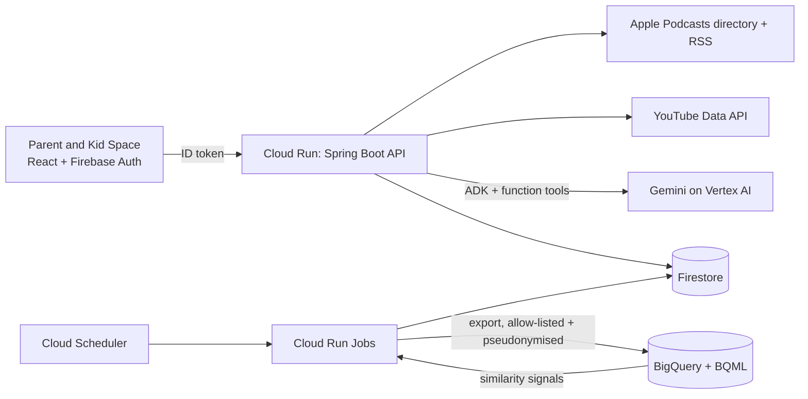

# Aram

**A world of learning, thoughtfully chosen.** Aram is a calm, parent-led space where a child watches YouTube channels and listens to podcasts that a parent has chosen, and nothing else.
Gemini does the vetting and explains its reasoning; the parent always has the final say. Built for families in India (first screens and audio for 3 to 6 year olds), with an architecture that carries to any region or language.

## What it does

- **Parent portal.** The parent signs in, adds the child's first name and birth month, picks interests, and builds the child's library from suggestions or by chatting to **Aram** (below). Nothing is added until the parent presses **Save**.
- **Aram Agent.** A chat built on Google's Agent Development Kit with Gemini on Vertex AI. Paste a YouTube link, an @handle, an Apple Podcasts link, or just a name: the agent finds it, screens look-alike search results for the child's age,
  runs a strict child-safety check, and stages it for the parent's approval. Conversations are kept on the server and can be resumed or cleared with "New chat".
- **Kid Space.** The child's home: top picks, a shelf per channel and podcast, a video watch page and a podcast player. Only approved sources are ever served, and the backend enforces that (a video id typed into the address bar must belong to an approved channel).
- **Recommendations.** "Similar to" suggestions come from embeddings of public catalog text computed in BigQuery, applied only after the age and safety eligibility filter.
- **Book picks.** The parent portal suggests picture books from a reviewed list, each with a link to buy it. Books are filtered to the child's age, matched to the parent's interests, and ranked by the BigQuery ML recommendation engine (embeddings of book text compared with the channels and podcasts the child already has: "Similar to ..."). Books are never shown in Kid Space.
- **Catalog growth with a human in the loop.** A builder finds candidate channels and podcasts and has Gemini draft assessments, but only a person applying a review sheet can make a source recommendable.

## Built on Google Cloud

| Service | What it does in Aram |
|---|---|
| **Cloud Run** | Backend API (Spring Boot), frontend (nginx), and three scheduled jobs (analytics export, recommendations, YouTube data refresh) |
| **Firebase Authentication** | Parent sign-in with Google or email and password; the backend verifies the ID token and takes the parent id only from it |
| **Firestore** | The operational source of truth: canonical content catalog, append-only assessments, the family's choices, staged submissions, caches, agent conversations |
| **Gemini on Vertex AI** | The agent's tool-calling loop, the strict per-channel safety check, and the screening of name-search results; a fallback model takes over if the primary one stalls |
| **Agent Development Kit (Java)** | Runs the agent: function tools, model loop, and Firestore-backed sessions (decision 0014) |
| **BigQuery and BigQuery ML** | Pseudonymised analytics (allow-listed fields only) and text embeddings, vector search and clustering for "similar to" suggestions, written back to Firestore |
| **Cloud Scheduler, Secret Manager, Artifact Registry, Cloud Monitoring** | Daily and weekly jobs, secrets (never in the repository), container images, a failure alert |

The full data model and rules are in [docs/architecture.md](docs/architecture.md).

## Safety and privacy by design

- **The AI never approves.** The model can find, check and stage a source; only the parent's Save approves it. Anything not clearly safe is blocked, and there is no override. Safety policy lives in code, not in a prompt.
- **Three layers before a parent sees a result.** Deterministic rules (explicit shows and non-children's genres are dropped), one Gemini screening call that fails closed, then a strict assessment of the chosen item. Text from channels and tool results is treated as data, never as instructions.
- **Playback is authorised on the server** for every request, and podcast audio that a publisher's host refuses is hidden rather than shown as a dead tile (decision 0015).
- **Data minimisation.** Child's first name and birth month only. Names, emails, user ids and birth dates never reach BigQuery (canary tests prove it); agent conversations are never exported and expire after 7 days idle; there is no long-term memory.
- **YouTube terms.** API data is refreshed within 30 days by a scheduled job (decision 0011).

## Data sources and limits

YouTube Data API v3 (public channel and video metadata), the Apple Podcasts directory and publishers' own RSS feeds (22 curated channels and 33 curated podcasts to start). No children's viewing history is collected or used for recommendations.
Known limits: approval is per channel, not per video; YouTube quota and Gemini rate limits apply; the age and tag labels for the starter catalog are the developers' judgement and a recommendation evaluation set is still provisional;
social features, individual-episode approval, Spotify and an admin UI are not built (see "What's not built yet").

