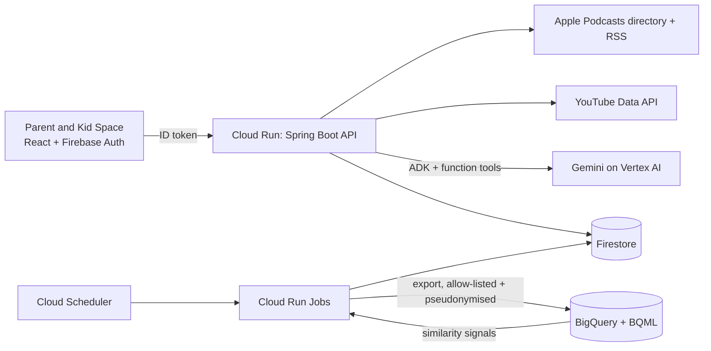

# Aram

**A world of learning, thoughtfully chosen.** Aram is a calm, parent-led space where a child watches YouTube channels and listens to podcasts that a parent has chosen, and nothing else.
Gemini does the vetting and explains its reasoning; the parent always has the final say. Built for families in India (first screens and audio for 3 to 6 year olds), with an architecture that carries to any region or language.

**Live app:** https://aram-frontend-hynztkzhza-uc.a.run.app (sign in with Google, or create an account with an email and password; a new account starts with onboarding and an empty library).

## What it does

- **Parent portal.** The parent signs in, adds the child's first name and birth month, picks interests, and builds the child's library from suggestions or by chatting to **Aram** (below). Nothing is added until the parent presses **Save**.
- **Aram Agent.** A chat built on Google's Agent Development Kit with Gemini on Vertex AI. Paste a YouTube link, an @handle, an Apple Podcasts link, or just a name: the agent finds it, screens look-alike search results for the child's age,
  runs a strict child-safety check, and stages it for the parent's approval. Conversations are kept on the server and can be resumed or cleared with "New chat".
- **Kid Space.** The child's home: top picks, a shelf per channel and podcast, a video watch page and a podcast player. Only approved sources are ever served, and the backend enforces that (a video id typed into the address bar must belong to an approved channel).
- **Recommendations.** "Similar to" suggestions come from embeddings of public catalog text computed in BigQuery, applied only after the age and safety eligibility filter.
- **Catalog growth with a human in the loop.** A builder finds candidate channels and podcasts and has Gemini draft assessments, but only a person applying a review sheet can make a source recommendable.

## Built on Google Cloud

| Service | What it does in Aram |
|---|---|
| **Cloud Run** | Backend API (Spring Boot), frontend (nginx), and three scheduled jobs (analytics export, recommendations, YouTube data refresh) |
| **Firebase Authentication** | Parent sign-in with Google or email and password; the backend verifies the ID token and takes the parent id only from it |
| **Firestore** | The operational source of truth: canonical content catalog, append-only assessments, the family's choices, staged submissions, caches, agent conversations |
| **Gemini on Vertex AI** | The agent's tool-calling loop, the strict per-channel safety check, and the screening of name-search results; a fallback model takes over if the primary one stalls |
| **Agent Development Kit (Java)** | Runs the agent: function tools, model loop, and Firestore-backed sessions (decision 0014) |
| **BigQuery and BigQuery ML** | Pseudonymised analytics (allow-listed fields only) and text embeddings, vector search and clustering for "similar to" suggestions, written back to Firestore |
| **Cloud Scheduler, Secret Manager, Artifact Registry, Cloud Monitoring** | Daily and weekly jobs, secrets (never in the repository), container images, a failure alert |



The full data model and rules are in [docs/architecture.md](docs/architecture.md); every departure from it is a numbered decision in [docs/decisions/](docs/decisions).

## Safety and privacy by design

- **The AI never approves.** The model can find, check and stage a source; only the parent's Save approves it. Anything not clearly safe is blocked, and there is no override. Safety policy lives in code, not in a prompt.
- **Three layers before a parent sees a result.** Deterministic rules (explicit shows and non-children's genres are dropped), one Gemini screening call that fails closed, then a strict assessment of the chosen item. Text from channels and tool results is treated as data, never as instructions.
- **Playback is authorised on the server** for every request, and podcast audio that a publisher's host refuses is hidden rather than shown as a dead tile (decision 0015).
- **Data minimisation.** Child's first name and birth month only. Names, emails, user ids and birth dates never reach BigQuery (canary tests prove it); agent conversations are never exported and expire after 7 days idle; there is no long-term memory.
- **YouTube terms.** API data is refreshed within 30 days by a scheduled job (decision 0011).

## Data sources and limits

YouTube Data API v3 (public channel and video metadata), the Apple Podcasts directory and publishers' own RSS feeds (22 curated channels and 33 curated podcasts to start). No children's viewing history is collected or used for recommendations.
Known limits: approval is per channel, not per video; YouTube quota and Gemini rate limits apply; the age and tag labels for the starter catalog are the developers' judgement and a recommendation evaluation set is still provisional;
social features, individual-episode approval, Spotify and an admin UI are not built (see "What's not built yet").

## Try it

- **Live:** open the link above, sign in, finish onboarding, then open **Aram AI Agent** and ask for a channel or a podcast by name.
- **Locally:** follow sections 1 and 3 below (`backend/config/application.yml` holds your own keys and is never committed). Backend: `cd backend && ./gradlew bootRun` (port 8080). Frontend: `cd frontend && npm install && npm run dev` (port 5173).
- **Tests:** `cd backend && ./gradlew test` (about 410 tests, including the privacy and playback-authorisation suites) and `cd frontend && npm run build && npm run lint`.

## Repository map

[backend/](backend) Spring Boot 3.5 on Java 17 (`catalog`, `agent`, `podcast`, `analytics`, `ml`, `auth`, `controller`, `service`) with deploy scripts in `backend/deploy` · [frontend/](frontend) React, Vite and Tailwind (Kid Space at `/`, parent portal at `/parent/*`) · [docs/](docs) architecture and decision records.

---

## 1. One-time Google Cloud setup

You'll need a Google Cloud project. These steps only need to be done once.

```bash
gcloud projects create YOUR_PROJECT_ID --name="Aram"
gcloud config set project YOUR_PROJECT_ID
```

### Enable the required APIs

```bash
gcloud services enable \
  youtube.googleapis.com \
  firestore.googleapis.com \
  firebase.googleapis.com \
  identitytoolkit.googleapis.com \
  aiplatform.googleapis.com \
  run.googleapis.com \
  cloudbuild.googleapis.com \
  artifactregistry.googleapis.com
```

### Create a YouTube Data API key

The YouTube Data API is called with a plain API key (not OAuth), since you're only reading
public channel/video data.

Create the key in the **same project** as everything else and restrict it to the YouTube API:

```bash
gcloud services enable youtube.googleapis.com apikeys.googleapis.com --project=YOUR_PROJECT_ID
gcloud services api-keys create --project=YOUR_PROJECT_ID --display-name="aram-youtube" \
  --api-target=service=youtube.googleapis.com
```

(Or in the console: **APIs & Services → Credentials → Create credentials → API key**, then
**Restrict key → YouTube Data API v3**.) Leave "Application restrictions" as **None**: the key is
used server-side and Cloud Run has no static outbound IP. Put the key in
`backend/config/application.yml` (see "Running locally"), never in source control.

### Create a Firestore database

```bash
gcloud firestore databases create --project=YOUR_PROJECT_ID --location=us-central1 --type=firestore-native
```

The location **cannot be changed later**, so pick it deliberately (`gcloud firestore locations
list`) and keep Cloud Run in the same region.

### Set up parent sign-in (Firebase Authentication)

Parents sign in with Google; the backend verifies the Firebase ID token on every `/api/*` call
(except `/api/tags`) and takes the parent's identity from it, never from the request.

1. [Firebase console](https://console.firebase.google.com) → **Add project** → pick your existing
   Google Cloud project (no Analytics needed).
2. **Build → Authentication → Get started → Sign-in method → Google → Enable** (choose a support email).
   Also enable **Email/Password** (first switch only, not "Email link"): the sign-in page offers "Create an account" and "Sign in" with an email and password next to Google, which is how a reviewer can be given a login without a Google account.
3. **Project settings → Your apps → Add app → Web**, then copy the config values into
   `frontend/.env` (see "Frontend" below). They are public identifiers, not secrets.
4. **Authentication → Settings → Authorized domains**: `localhost` is there by default; add your
   deployed frontend domain later.

The backend needs no extra secret: on Cloud Run and locally it verifies tokens with the project's
public keys using the Application Default Credentials below.

### Set up Application Default Credentials for local development

```bash
gcloud auth application-default login
```

This lets the backend talk to Firestore locally using *your* credentials. On Cloud Run, the
service's attached service account is used automatically instead — no key file needed either
way.

---

## 2. The catalog and the seed job

Channels live in Firestore, not in the app. [channels.json](backend/src/main/resources/channels.json)
(with [tags.json](backend/src/main/resources/tags.json) and
[categories.json](backend/src/main/resources/categories.json)) are the **reviewed seed data**: one run of
the seed job resolves each channel's `@handle` (or `UC...` id) on YouTube and writes the taxonomy, a
canonical source per channel and a first assessment for it. It is safe to run again (existing sources are
skipped). It is off by default so normal startups never write:

```bash
cd backend
ARAM_SEED_ENABLED=true PORT=8081 ./gradlew bootRun    # stop it after "Catalog seed finished"
```

Each `channels.json` entry looks like this (ages are whole years there; Firestore stores months):

```json
{
  "id": "khan-academy-kids",
  "name": "Khan Academy Kids",
  "category": "Early Learning",
  "description": "Free lessons covering math, reading and more.",
  "minAge": 2, "maxAge": 8,
  "youtubeHandle": "@khanacademykids",
  "tags": ["math", "phonics-reading"]
}
```

- Use `youtubeHandle` (the `@name` in the channel's URL), or `youtubeChannelId` (`UC...`) if it has none.
- `tags` must be ids from `tags.json`. `category` is no longer stored: a channel's category is derived from
  its first tag's category.
- The seeded channels are recorded as `APPROVED_FOR_RECOMMENDATION` by a *developer review*
  (`assessorType: CURATED_SEED`, `evidenceLevel: DEVELOPER_REVIEW`) with the limitation written on the record:
  chosen from public channel information, individual videos not reviewed. Double-check each channel before a
  real launch.

### Podcasts

A podcast is a `content_source` of type `PODCAST_FEED` (id `podcast_<Apple collection id>`, platform
`APPLE_PODCASTS`) with its RSS address in `feedUrl`; assessment, staging, Save and approval work exactly as for
YouTube channels. The starter shows (about 30) live in [podcasts.json](backend/src/main/resources/podcasts.json) (by Apple id,
with ages in years) and are seeded by the same job; **check the ages and tags there before a real launch**, they are
the developers' judgement.

- **Episodes** are read from the feed on demand (only the newest ~10; some feeds hold a thousand), cached in
  `episode_cache` (`aram.podcast.cache-ttl-minutes`, default 360) and served stale if the feed is down.
  Episodes the publisher marks explicit, or without a plain http(s) audio link, are dropped.
- **Playability check (`PodcastAudioCheck`).** A feed can keep listing episodes whose files the publisher has removed or locked (the audio host answers 403/404, or serves an error page), so a child would press play on
  something that never starts. The newest episode's audio is requested (first kilobyte, through the same guarded fetcher); a clear refusal hides the show's episodes from Kid Space and makes the agent refuse to add it
  ("its audio isn't available"). Timeouts, 5xx and rate limits count as *unknown* and never hide a show. Results are kept in memory (an hour for working audio, 15 minutes for a refusal); nothing is stored.
  Found this way: *The Imagine Neighborhood* (every episode answered 403), now removed from the starter list and retired in the catalog.
- **Playback** is a plain `<audio>` element in Kid Space. Audio streams from each show's own host; some shows
  insert ads that Aram cannot remove. Only approved shows are served (`/api/podcast-feed`,
  `/api/podcasts/{id}/episodes`), and an approved show never plays through the YouTube endpoints.
- **Feed addresses come from a public directory anyone can publish to**, so the backend only fetches http(s) addresses on
  the public internet (not loopback, private, link-local or similar), re-checks every redirect, caps the size and time,
  and parses with DTDs and external entities off. Known limit: the name is checked and then resolved again by the HTTP
  client, so keep the backend off networks it should not reach.
- Live check against the real directory and feeds (no key, no database), skipped by default:
  `ARAM_LIVE_PODCASTS=true ./gradlew test --tests '*PodcastLiveTest' --info`.

### Data model (Firestore)

Follows the data-model specification (one canonical catalog; saving, assessing and approving kept separate).
Doc ids are in brackets.

| Collection | One document per | Notes |
|---|---|---|
| `parents` (uid) | parent | display name, handle, `accountStatus`; Firebase Auth uid is the id |
| `children` (`<uid>-c1`) | child | `birthYearMonth` (YYYY-MM) only; age is computed, never stored |
| `categories`, `tags` | taxonomy entry | mirrored from the JSON files by the seed job; ages in months |
| `parent_interests` (`<childId>_<tagId>`) | selected tag | the parent's picks; they never approve a channel |
| `content_sources` (`youtube_<UC id>`) | channel | canonical; the id makes duplicates impossible |
| `content_assessments` (auto) | assessment | append-only: status, age range in months, evidence level, limitations, model and `policyVersion` |
| `content_submissions` (`<childId>_<sourceId>`) | request to add a channel | `READY_FOR_PARENT` = staged for Save; 24 h expiry |
| `child_catalog_entries` (`<childId>_<sourceId>`) | approval decision | `APPROVED` / `REVOKED`; the only thing that authorizes playback |
| `video_cache`, `episode_cache` | channel / podcast | cached latest videos and episodes (not in the spec; avoids burning API quota and re-reading feeds) |

How the rules are enforced (all in the backend, never trusting the browser):

- A source can be approved for a child only if it is live (`catalogStatus: ACTIVE`), its latest assessment
  cleared it (`ASSESSED` or `APPROVED_FOR_RECOMMENDATION`) and the child's age in months is inside its range. One stretch (decision 0010): a 4-year-old
  may also be offered sources whose minimum age is up to a year higher; they are marked "aimed a little older" and ranked after in-range ones.
  Missing age information means *not eligible*. This one rule is used by recommendations, the agent and Save.
- Channels the model did not clear confidently are stored as `UNDER_REVIEW` (so a second parent asking for
  the same channel is recognised, not re-assessed) and are never offered to anyone.
- Suggestions only include `APPROVED_FOR_RECOMMENDATION` channels; a channel a parent added through the
  agent (`ASSESSED`) can be added by others who ask for it, but isn't suggested until a human reviews it.
- Playback: `/api/feed` and `/api/channels/{id}/videos` serve only channels with an `APPROVED` entry for the
  signed-in parent's child, and stop immediately if the source is later rejected.
- Not built (deliberately): follows, shares, saved/dismissed relationships, individual videos
  (`content_items`) and recommendation events. Approval is per channel, so future uploads from an approved
  channel are shown. The queries used are all equality filters, so no composite indexes are needed yet.

---

## 3. Running locally

### Backend

Copy the example config and fill in your project id and YouTube key. The copy is git-ignored:

```bash
cd backend
cp config/application.yml.example config/application.yml   # then edit it
./gradlew bootRun
```

Spring Boot loads `backend/config/application.yml` automatically, so nothing needs exporting in
each terminal. The startup log prints `Firestore project: ...` — check it names the project you
expect. (If `aram.firestore.project-id` is left blank, the backend silently uses whichever
project `gcloud` has active, and logs a warning.)

Runs on http://localhost:8080. Try:

```bash
curl http://localhost:8080/api/channels
curl http://localhost:8080/api/feed
```

### Frontend

```bash
cd frontend
cp .env.example .env    # then fill in the VITE_FIREBASE_* values from the Firebase console
npm install
npm run dev
```

Runs on http://localhost:5173. Every page requires a signed-in parent; you are sent to `/signin` first.

**Testing sign-in without Google:** run the Firebase Auth emulator
(`npx firebase-tools emulators:start --only auth --project YOUR_PROJECT_ID`), start the backend with
`FIREBASE_AUTH_EMULATOR_HOST=127.0.0.1:9099`, and set `VITE_FIREBASE_AUTH_EMULATOR=http://127.0.0.1:9099`
in `frontend/.env.local`. Never set these in a deployed environment.

---

## 3b. The Aram Agent (Gemini on Vertex AI)

The parent portal's **Aram AI Agent** page lets a parent add a YouTube channel by chatting: paste a
link, an `@handle`, a channel id, or a plain name, or a **podcast** by Apple Podcasts link or name.
The agent finds the channel or show, a Gemini
child-safety check runs for the child's age, and the result is **staged**. Nothing is saved until
the parent clicks **Save**, and the server re-checks the stored verdict at that point.

- **Needs** the Vertex AI API enabled (above) and billing linked to the project.
- **Safety policy** lives in code, not in the model: a channel is only offered if Gemini says `SAFE`,
  age-appropriate, with `HIGH` confidence. Malformed answers, outages and anything unclear are blocked.
  The check reads the channel description and recent video titles; it cannot watch videos or read comments.
- **Models** are set under `aram.gemini` (defaults: `gemini-3.8-flash` on the `global` endpoint,
  falling back to `gemini-2.5-flash` if the first attempt stalls or fails; 10 s timeout per attempt).
  Each saved channel records which model judged it.
- **Framework: Google ADK (decision 0014).** The model loop runs on Google's Agent Development Kit for Java (`com.google.adk:google-adk`) with Gemini on Vertex AI:
  the four tools (`find_channel`, `assess_channel`, `find_podcast`, `assess_podcast`) are ADK function tools that call the application's own code, so the parent id and the child's age
  come from the server, never from the model. `aram.agent.engine=adk` turns it on (`custom` is the hand-written loop, the default in code and the switch-back; any ADK error falls back to it
  for that request, and the ADK run itself fails over from `gemini-3.8-flash` to `gemini-2.5-flash`). The deployed service sets `ARAM_AGENT_ENGINE=adk`.
- **Conversations are kept on the server (ADK sessions in Firestore).** With `aram.agent.sessions-enabled=true` (`ARAM_AGENT_SESSIONS_ENABLED=true`) the browser sends a `sessionId` plus the new message,
  reloading the page resumes the latest conversation (text and the last cards), and **New chat** deletes it. Sessions are stored under the signed-in parent's id (another parent's id is a 404), hold plain
  chat text only (no tool results), expire after 7 days idle (`aram.agent.session-retention-days`), are never exported to BigQuery, and there is **no long-term memory** between conversations.
  Collection: `adk-session` (architecture 3.16).
- **Podcasts** use two more tools, `find_podcast` and `assess_podcast`: names are searched in Apple's free
  public directory (no key); the parent picks from cards because look-alike shows with the same name exist.
  The show's RSS feed is read for its description and recent episode titles. A show marked **explicit** by its
  publisher or the directory is refused in code before any model is asked. See "Podcasts" below.
- **Not supported yet:** removing channels through chat, daily time limits, bedtime cut-offs, keyword
  blocking, and Spotify shows (Spotify has no open playback).

Live checks against the real model are skipped by default (they cost a few cents):

```bash
cd backend
ARAM_LIVE_GEMINI=true ARAM_LIVE_PROJECT=your-project ./gradlew test \
  --tests '*GeminiClientLiveTest' --tests '*ChannelSafetyLiveTest' --info
# add ARAM_LIVE_MODEL=gemini-2.5-flash to run the safety cases against the fallback model

# the Stories Podcast search on both agent engines (ADK and the built-in loop), real Gemini and Apple, family data mocked
ARAM_LIVE_AGENT=true ARAM_LIVE_PROJECT=your-project ./gradlew cleanTest test --tests '*AdkAgentLiveTest' --info
```

**Speed.** Catalog sources are kept in memory for about a minute and read in one batch instead of one document at a time (`CatalogRepository`); the video feed, podcast feed and top picks fetch their channels in parallel (`util/Parallel`); and the pages show what they have as it arrives (home shelves, Manage Channels suggestions, the watch page's other shelves). Other instances or jobs can be up to a minute behind a catalog change. There is deliberately no Redis or pagination yet: the data is small and the first-request delay comes from the backend scaling to zero (a minimum of one instance would remove it).

**Podcast player.** Podcast episode tiles (Kid Space shelves and top picks) open `/listen/<show>/<episode>`, a now-playing page with the cover, title, description, seek bar, back 10 s / forward 30 s, play/pause and speed. It plays the show's own audio file, only for approved shows. The rest of the page is intentionally empty for now; heart, queue, bedtime timer and "wonder question" from the first design are not built.

**Where the agent lives.** "Aram AI Agent" is a page in the parent sidebar (`/parent/agent`, chat and pending changes side by side). A chat button in the corner of the parent screens opens a small starter box when nothing has been started, and sending the first message takes the parent to the page; once a chat or pending channels exist the button goes straight to the page. "Add a new channel" on Manage Channels also goes to the page.

**Search results are screened first (decision 0013).** When a parent gives the agent a plain name, the results are checked for the child's age before any card is shown:
explicit shows and shows outside the children's Apple genres are dropped in code, then one Gemini call keeps only results that are clearly children's content for that age. If the
screening cannot run, nothing is shown and the agent asks for a link instead. The strict check of the chosen channel or show happens afterwards, as before.

---

## 3c. Analytics (BigQuery)

A scheduled export copies a **minimal, pseudonymised** slice of Firestore into BigQuery (dataset
`children_content_analytics`, location `us-central1`, the same region as Firestore). Firestore stays the source of truth;
BigQuery is only for analytics (and, later, ML). Nothing in BigQuery decides safety or approval.

**The privacy boundary is code, not convention.** The columns in
[ExportTables.java](backend/src/main/java/com/aram/backend/analytics/ExportTables.java) are the whole allowlist. Each table is built
column by column from named fields (never by copying a document), so a new Firestore field is not exported unless someone adds a column.

- **Never exported:** parent name/handle/email, Firebase uids, child name, birth month, anything a parent typed, a model's per-child
  explanation, URLs of thumbnails/feeds, subscriber counts.
- **Pseudonyms:** parent and child ids become `HMAC-SHA256(secret key, id)` (32 hex chars). The key comes from `ANALYTICS_HMAC_KEY` and is
  never defaulted; the job refuses to start without it. Changing the key rewrites every pseudonym on the next run.
- **Coarse data:** exact birth month becomes an age band (`<1y, 1-2y, ... 12-18y`); family dates are a month or a day; assessments are
  truncated to the hour.
- **Analyst views** (`children_content_analytics_views`) hide any group smaller than 5 families, so with one family they are empty by design.

| Table | Mode | Contents |
|---|---|---|
| `dim_categories`, `dim_tags` | snapshot | the taxonomy |
| `dim_content_sources`, `bridge_content_tags` | snapshot | channels and podcasts, and where each tag came from (`CURATED`, `LLM_PROPOSED`, `HUMAN_REVIEWED`) |
| `fact_content_assessments` | incremental by assessment time | the append-only assessment history (status, ages in months, evidence level, limitations, model and policy versions) |
| `dim_parents`, `dim_children` | snapshot | pseudonymous ids, status, language, age band, created month |
| `fact_parent_interests`, `fact_child_catalog_entries` | snapshot | picked tags and approval status per child |
| `ops_export_runs` | append | one row per table per run: counts, status, attempt, error class, checkpoint (no row contents) |

*Snapshot* tables are merged to match Firestore exactly (so deletions propagate); *incremental* tables only add new rows and keep a
checkpoint that moves only after a successful run. Not built yet, on purpose: events (recommendation/playback), follows, shares and items.

**Current state:** the dataset, tables and views exist in `sproutly-508503` (`us-central1`). The export runs daily at 02:00 Asia/Kolkata as the Cloud Run Job `aram-analytics-export` (service account `aram-analytics-export`, secret `aram-analytics-hmac-key`, scheduler job `aram-analytics-export-daily`); deployment steps are in section 3f. A scheduled run only creates and checks tables; the analyst views and their authorisation are set up by a person with `--init-only` (the job account cannot touch the views dataset). Note: this machine's `gcloud` crashes on Scheduler/Run commands (Python 3.9), so use `backend/deploy/jobs.py` (REST).

**Running it** (from `backend/`; set `aram.export.hmac-key` in `config/application.yml` or `ANALYTICS_HMAC_KEY` first):

```bash
# Look first: reads Firestore, prints row counts and column lists, writes nothing
ARAM_EXPORT_ENABLED=true ./gradlew bootRun --args='--spring.main.web-application-type=none --dry-run'
# Create/validate the dataset, tables and views
ARAM_EXPORT_ENABLED=true ./gradlew bootRun --args='--spring.main.web-application-type=none --init-only'
# Export for real (non-zero exit code if any table failed)
ARAM_EXPORT_ENABLED=true ./gradlew bootRun --args='--spring.main.web-application-type=none'
# Delete one family's pseudonymous rows everywhere (by Firebase uid; the uid itself is never sent to BigQuery)
ARAM_EXPORT_ENABLED=true ./gradlew bootRun --args='--spring.main.web-application-type=none --purge-parent=<uid>'
```

Other options: `--tables=dim_tags,dim_parents`, `--force` (allow a snapshot to remove more than half of a table; otherwise refused).
Failures are retried (3 attempts with backoff); one table failing does not stop the others; the live table is checked against the
definition before every write (schema drift stops that table).

**Retention:** the run log expires after 90 days. Assessments are kept without expiry on purpose: they describe public catalog content,
and expiring the only assessment of a stable channel would break "latest assessment per source" queries.

Tests keep sensitive fields out: sentinel values (names, emails, uids, birth months, free text, unknown fields) are planted in every kind of
Firestore document and must not appear in any exported row. A live test against a throwaway dataset is skipped by default:
`ARAM_LIVE_BIGQUERY=true ARAM_LIVE_PROJECT=<project> ./gradlew test --tests '*BigQueryLiveTest' --info`.

---

## 3d. Growing the catalog: the builder and the YouTube refresh

Both are one-shot jobs like the seed and export jobs (run from `backend/`, they exit when done).

**Catalog builder** (`ARAM_BUILDER_ENABLED=true`, decision 0012) finds candidate channels and podcasts, has Gemini assess them with the same strict
check the agent uses, and writes a review sheet. **It never approves anything**; only a person applying the sheet can make a source recommendable.

```bash
# 1. Look first: runs the searches and filters, prints who it would assess; no model calls, writes nothing
ARAM_BUILDER_ENABLED=true ./gradlew bootRun --args='--spring.main.web-application-type=none --dry-run --max-searches=10'
# 2. Real run: assess up to 40 new candidates (stored as ASSESSED / UNDER_REVIEW) and write backend/build/review/review-<time>.csv
ARAM_BUILDER_ENABLED=true ./gradlew bootRun --args='--spring.main.web-application-type=none --max-searches=20 --max-new=40'
# 3. Open the CSV, fill the last columns for each READY row (decision approve|reject|skip, optional final_tags like "science;art", ages in years, notes), save it
# 4. Apply your decisions (the whole sheet is checked first; one bad row changes nothing; applying twice is harmless)
ARAM_BUILDER_ENABLED=true ./gradlew bootRun --args='--spring.main.web-application-type=none --apply-review=backend/build/review/review-<time>.csv --reviewer=your-name'
```

A batch calls Gemini once per candidate; the 10-second chat timeout is too tight for long channel descriptions (a first batch lost 7 of 40 to timeouts; a timed-out check is
never stored, so a rerun retries it). For batches raise it: `ARAM_GEMINI_REQUEST_TIMEOUT_MILLIS=40000 ARAM_BUILDER_ENABLED=true ./gradlew bootRun ...`.

Options: `--youtube-only`, `--podcasts-only`, `--max-searches=n`, `--max-new=n`, `--include-held=UC...` (assess a channel YouTube marks "not made for kids"; they are listed in
`held-back-<time>.csv` instead). Searches come from the reviewed list in [catalog-queries.json](backend/src/main/resources/catalog-queries.json). **Quota:** each YouTube search costs about 101 of
the 10,000 daily units (the dry run reports it); Apple's podcast directory is free. **Filters applied before any model call:** already in the catalog, duplicates, tiny channels, podcasts marked
explicit or outside children's genres, names mostly in another script, names that say Hindi/Tamil/Telugu/etc. or a channel whose declared YouTube language is not English, feeds not in English (English first); look-alikes of existing or other new sources are flagged in the sheet. A source the model
refused shows as "MODEL REFUSED" and can be rejected but not approved. The sheet contains public catalog data only.

**YouTube refresh** (`ARAM_REFRESH_ENABLED=true`, decision 0011): YouTube only lets us keep its data for 30 days unless refreshed, so this re-reads every YouTube channel in the catalog (50 per call, 1 quota unit
per call), updates handle, thumbnail, subscriber count and the verification date, and takes any channel YouTube no longer returns out of the live catalog. Run it at least every 14 days:

```bash
ARAM_REFRESH_ENABLED=true ./gradlew bootRun --args='--spring.main.web-application-type=none --dry-run'   # then without --dry-run
```

---

## 3e. Recommendation engine (BigQuery ML, decisions 0008 and 0009)

Content-based "more like this" from **public catalog text only** (name, description, topic names; never family data). Embeddings and nearest neighbours are
computed in BigQuery (dataset `children_content_analytics_ml`); the backend clusters them, labels the clusters and writes `source_signals/{sourceId}` to
Firestore. The app never calls BigQuery per request. The model never decides safety, age or approval: the recommender applies the eligibility policy to every
candidate first. Blending is **off by default in code** (`ARAM_ML_BLEND_ENABLED=false`); the deployed service turns it on, while the evaluation labels are still provisional.

One-time cloud setup (each step needs explicit approval; project always `sproutly-508503`):

```bash
# 1. BigQuery connection to Vertex AI, then let its service account call embedding models
bq mk --connection --location=us-central1 --project_id=sproutly-508503 --connection_type=CLOUD_RESOURCE aram-vertex
bq show --connection --location=us-central1 --project_id=sproutly-508503 aram-vertex   # note the serviceAccountId
gcloud projects add-iam-policy-binding sproutly-508503 --member="serviceAccount:<serviceAccountId>" --role="roles/aiplatform.user"
# 2. Make sure dim_content_sources has the description column (next export migrates it), then export
ARAM_EXPORT_ENABLED=true ./gradlew bootRun --args='--spring.main.web-application-type=none --init-only'
ARAM_EXPORT_ENABLED=true ./gradlew bootRun --args='--spring.main.web-application-type=none'
# 3. Create the ML dataset and the remote embedding model
ARAM_ML_ENABLED=true ./gradlew bootRun --args='--spring.main.web-application-type=none --setup'
```

Each run (`--dry-run` prints the SQL and runs nothing; `--write-back-only` skips BigQuery):

```bash
ARAM_ML_ENABLED=true ./gradlew bootRun --args='--spring.main.web-application-type=none'
```

Order of work in a run: inputs, embeddings (`ML.GENERATE_EMBEDDING`, remote `text-embedding-005`), neighbours (`VECTOR_SEARCH`, cosine, overlapping ages only),
then clusters and the Firestore write-back. Settings are under `aram.ml.*` in `application.yml`. A brand-new child (fewer than `aram.ml.seed-count` approvals) is seeded from its best tag matches at half weight (`seed-damping`). Tests: `MlSqlTest`, `KMeansTest`, `MlPipelineServiceTest`,
`RecommendationBlendTest`.

---

## 3f. Deploying the scheduled jobs

Three Cloud Run Jobs share one image (`aram/aram-backend` in Artifact Registry) and differ only by env flag: `aram-analytics-export` (02:00 IST daily),
`aram-recommendations` (03:00 IST daily, after the export) and `aram-catalog-refresh` (04:00 IST Sundays; YouTube data must be refreshed within 30 days,
decision 0011). Each runs as its own least-privilege service account. `backend/deploy/jobs.py` does the REST calls (gcloud's run/scheduler commands crash on
Python 3.9). Build the image from a host-built jar when Docker cannot download Gradle: `./gradlew bootJar`, copy the jar and `Dockerfile.prebuilt` into a clean folder,
`docker buildx build --platform linux/amd64 --push`.

```bash
cd backend
python3 deploy/jobs.py plan                  # prints what each step does; calls nothing
python3 deploy/jobs.py secret                # YouTube key -> Secret Manager (never printed)
python3 deploy/jobs.py jobs                  # create / update the three Cloud Run jobs
python3 deploy/jobs.py iam                   # each job's account may invoke its own job only
python3 deploy/jobs.py schedule              # scheduler jobs, created PAUSED
python3 deploy/jobs.py run aram-analytics-export   # test each job once (also aram-recommendations, aram-catalog-refresh)
python3 deploy/jobs.py resume                # start the schedules
python3 deploy/jobs.py status
```

**Failure alert.** `backend/deploy/alerts.py` creates an email notification channel and the policy "Aram scheduled job failed" (any Cloud Run job execution that ends
with `result=failed`, checked every 5 minutes). It does not notice a job that never starts, such as a paused schedule; check `python3 deploy/jobs.py status` for that.

```bash
cd backend
python3 deploy/alerts.py channel --email you@example.com
python3 deploy/alerts.py policy
python3 deploy/alerts.py status
```

**Image cleanup.** The Artifact Registry repository `aram` keeps the 10 most recent versions of each image and deletes any older than 60 days beyond those
(cleanup policy `keep-recent-10` + `delete-older-than-60d`, set 2026-10-16, not a dry run; first possible deletion is mid-December 2026). A job or service
pinned to an image that falls out of the newest 10 would stop starting new instances, so redeploy jobs to the latest image (`IMAGE` in `deploy/jobs.py`) now and then.

**The backend service** (`aram-backend`, Cloud Run) uses the same image and runs as `aram-backend@` (Firestore user, Vertex AI user; it reads the YouTube key from
Secret Manager). It is reachable without a Google identity, but every `/api/me/...` call needs a verified Firebase ID token (only `/api/tags` is public).

```bash
cd backend
python3 deploy/service.py plan
python3 deploy/service.py secret-access                    # service account may read the YouTube key
python3 deploy/service.py deploy --origins http://localhost:5173   # create/update; --origins = the frontend addresses allowed by CORS
python3 deploy/service.py public                           # allow browser calls to the URL
python3 deploy/service.py status                           # prints the URL, checks /api/tags (200) and /api/me/profile (401)
```

Point the local frontend at it with `VITE_API_BASE_URL=<service url> npm run dev` in `frontend/`. When the frontend is deployed, re-run `deploy` with its address added to `--origins`.

**The web app** (`aram-frontend`, Cloud Run, nginx) is built on the host with the Firebase settings from `frontend/.env` and the backend address baked in
(`VITE_API_BASE_URL=<backend url> npm run build`), then packaged with `frontend/Dockerfile.prebuilt` (the Dockerfile's build stage cannot see `.env`).

```bash
cd backend
python3 deploy/frontend.py deploy             # create/update; prints the web address
python3 deploy/frontend.py public             # anyone may open the site (data calls still need sign-in)
python3 deploy/frontend.py authorize-domain   # Firebase Auth must list the address, or Google sign-in is refused
python3 deploy/service.py deploy --origins http://localhost:5173,<web address>   # backend CORS
python3 deploy/frontend.py status
```

---


## 4. Deploying to Cloud Run

### Backend

```bash
cd backend
gcloud run deploy aram-backend \
  --source . \
  --region us-central1 \
  --allow-unauthenticated \
  --set-env-vars YOUTUBE_API_KEY=your-api-key-here,GOOGLE_CLOUD_PROJECT=YOUR_PROJECT_ID,ARAM_ALLOWED_ORIGINS=https://your-frontend-url.run.app
```

This builds the [Dockerfile](backend/Dockerfile) via Cloud Build and deploys it. Grant the
Cloud Run service's runtime service account Firestore access if it doesn't have it already:

```bash
gcloud projects add-iam-policy-binding YOUR_PROJECT_ID \
  --member="serviceAccount:YOUR-PROJECT-NUMBER-compute@developer.gserviceaccount.com" \
  --role="roles/datastore.user"
```

Note the deployed URL (`https://aram-backend-xxxxx.run.app`) — you'll need it for the
frontend build below.

Prefer not to pass the API key on the command line? Use
[Secret Manager](https://cloud.google.com/run/docs/configuring/services/secrets) and
`--set-secrets YOUTUBE_API_KEY=youtube-api-key:latest` instead.

### Frontend

The API base URL is baked into the JS bundle at build time, so build with `--build-arg`
pointing at your backend's Cloud Run URL:

```bash
cd frontend
gcloud builds submit --tag us-central1-docker.pkg.dev/YOUR_PROJECT_ID/cloud-run-source-deploy/aram-frontend \
  --substitutions=_API_BASE_URL=https://aram-backend-xxxxx.run.app

gcloud run deploy aram-frontend \
  --image us-central1-docker.pkg.dev/YOUR_PROJECT_ID/cloud-run-source-deploy/aram-frontend \
  --region us-central1 \
  --allow-unauthenticated
```

If `gcloud builds submit --substitutions` with a custom Dockerfile build-arg feels fiddly,
the simplest path is to build and push locally instead:

```bash
cd frontend
docker build --build-arg VITE_API_BASE_URL=https://aram-backend-xxxxx.run.app \
  -t us-central1-docker.pkg.dev/YOUR_PROJECT_ID/cloud-run-source-deploy/aram-frontend .
docker push us-central1-docker.pkg.dev/YOUR_PROJECT_ID/cloud-run-source-deploy/aram-frontend
gcloud run deploy aram-frontend \
  --image us-central1-docker.pkg.dev/YOUR_PROJECT_ID/cloud-run-source-deploy/aram-frontend \
  --region us-central1 --allow-unauthenticated
```

Then go back and set `ARAM_ALLOWED_ORIGINS` on the backend service to the frontend's
actual URL (CORS is locked down to that origin by default).

---

## API reference

| Method | Path | Description |
|--------|------|-------------|
All endpoints except `/api/tags` need `Authorization: Bearer <Firebase ID token>`; the parent is the
token's verified uid, so no endpoint accepts a parent id.

| Method | Path | Description |
|--------|------|-------------|
| GET | `/api/channels` | Channels approved for the child, then others the parent can choose from |
| GET | `/api/channels/{id}` | One visible channel's details |
| GET | `/api/channels/{id}/videos` | The channel's latest 5 videos plus its most viewed recent ones (the "more from this channel" shelf), only if the channel is approved for the child |
| GET | `/api/channels/{id}/videos/{videoId}` | One video for the watch page. Any video of an approved channel opens, but only if YouTube says it belongs to that channel (otherwise 404); a video outside the cache costs one quota unit and is then kept in memory for 10 minutes |
| GET | `/api/feed?channelIds=` | Latest videos per approved YouTube channel (optionally only the given ids) |
| GET | `/api/podcast-feed` | Latest episodes per approved podcast, keyed by show id |
| GET | `/api/me/top-picks?size=` | Kid Space's first block (`size` 1-40, default 10; the app asks for 30 and shows two rows at a time with "Show more"): popular videos (most viewed recent uploads, at most 2 per channel, no Shorts) mixed with the newest episode of approved podcasts, each with its length where known; re-sampled on every call, approved sources only |
| GET | `/api/podcasts/{id}/episodes` | Episodes of one approved podcast (404 if not approved) |
| GET | `/api/tags` | Interest tags offered during onboarding (public) |
| GET | `/api/me/recommendations` | Channels for this child, from the saved interests, after the eligibility filter |
| GET / PUT | `/api/me/profile` (+ `/basics` with `birthYearMonth`, `/tags`, `/channels`) | Parent and child profile, interests, approved channels |
| POST | `/api/me/agent/messages` | One chat turn with the agent. Body: `message`, optional `sessionId` (server-side conversation; omit to start one), `history` (used only when sessions are off). Returns the reply, candidate cards, staged channels and the `sessionId` |
| GET / DELETE | `/api/me/agent/session` / `/api/me/agent/session/{id}` | Resume the latest conversation (204 when none) / "New chat" (404 for an id that is not the caller's); only when sessions are on |
| GET | `/api/me/agent/staged` | Channels waiting for the parent's Save |
| POST | `/api/me/agent/save` / `/discard` | Approve or drop staged channels (by id only) |

## What's not built yet

- Social features, item-level approval, and recommendation and playback events (deferred on purpose, decision 0006; see the data model above).
- A reviewer path for promoting parent-added channels to `APPROVED_FOR_RECOMMENDATION`.
- Spotify shows, individual-episode approval, and agent actions beyond adding a channel or podcast (see above).
- Community features.
- Any admin UI for editing the catalog or taxonomy (they change by editing the JSON files and re-running the seed job).
